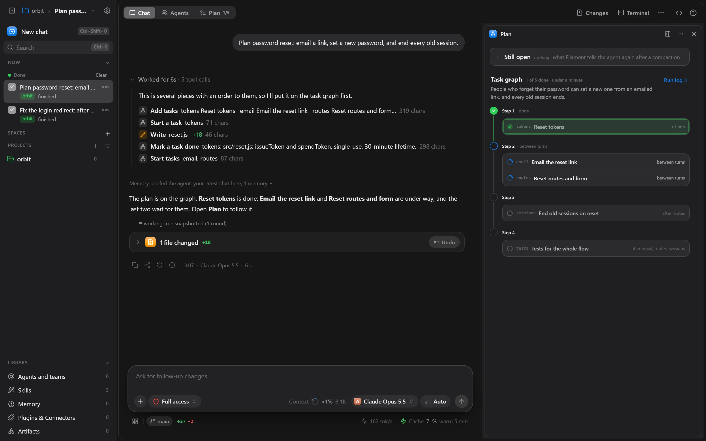
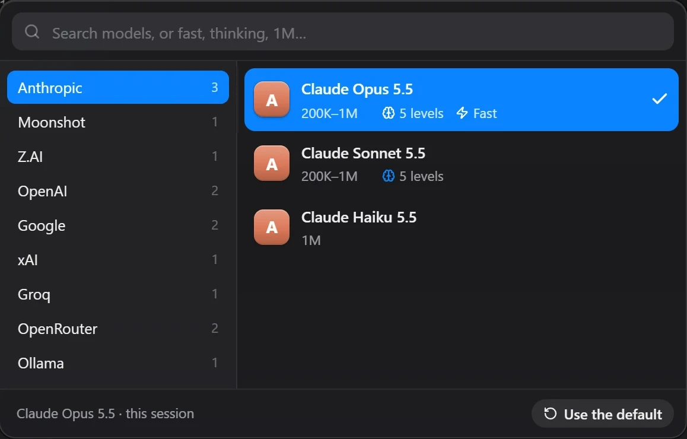
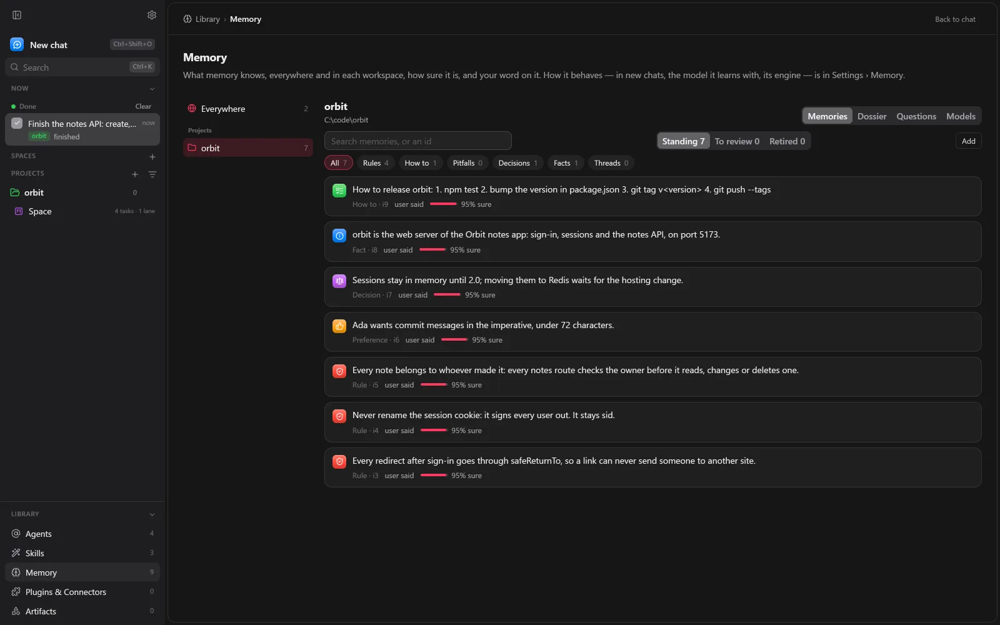
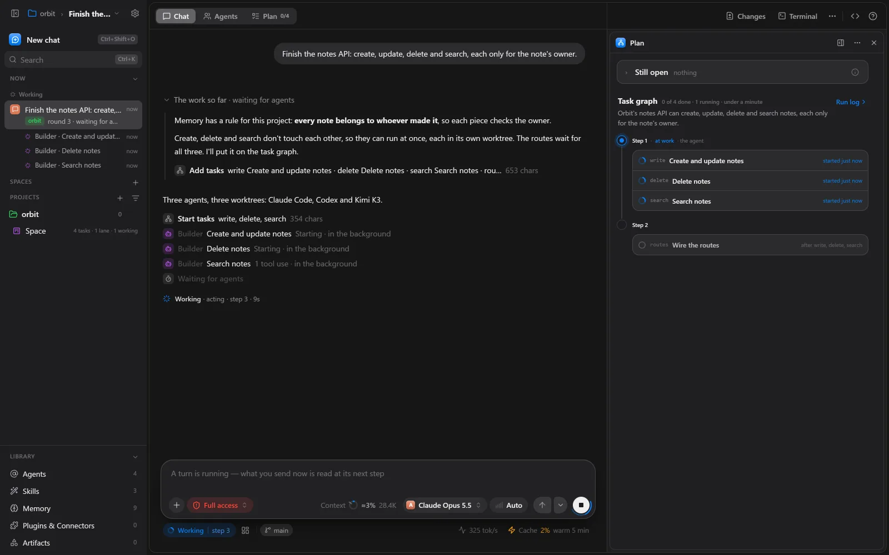
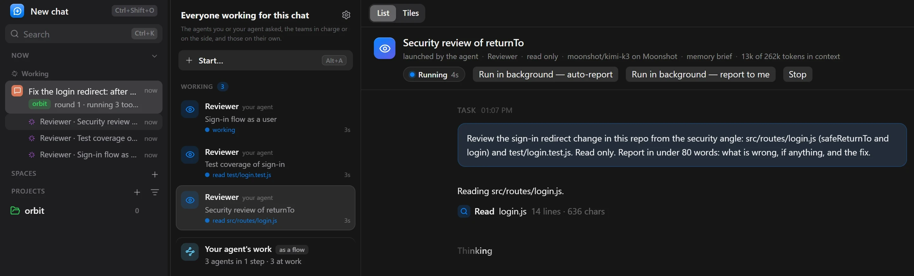
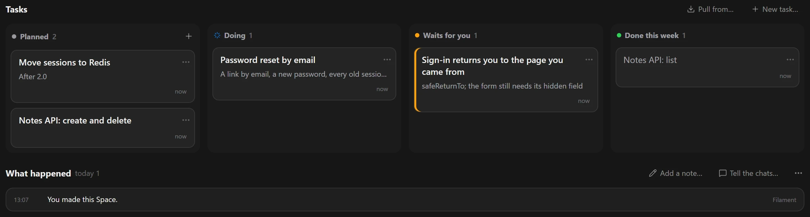

# Filament

**Any model. Any agent. One memory.**

[Download](https://filamentdev.com/download) · [Features](https://filamentdev.com/features) ·
[Guide](https://filamentdev.com/guide) · [Changelog](https://filamentdev.com/changelog)



Filament is an agent harness for developers: a desktop app for Windows, macOS and Linux, and a server for a Linux
machine. It runs any model you have a key or a plan for, and the coding agents already on your computer (Claude Code,
Codex, Cursor), in your project folder, with one memory they all share.

Filament is three things, in the order you will meet them:

1. **The harness**: Filament's own coding agent, in its own window or the browser. Any model works in your project
   folder with file, shell and web tools, sends sub-agents off, hands larger work to a team, and shows its whole
   context window as it fills.
2. **Memory**: one memory shared by every model and tool. It is on from the first start: what one session
   established, the next one knows, whichever model or agent asks.
3. **A local API for your other tools**: one address on your computer for any Anthropic- or OpenAI-format client.
   Behind it are your providers and the coding agents installed on your machine, with a backup when a provider fails
   and a record of what each request carried.

## A quick tour

### Every model you pay for. Every agent you use.

Filament's own agent runs on any model at any provider, even one on your own GPU. Or let it drive Claude Code, Codex
and Cursor on the plans you already have. When a provider is busy or refuses, the turn goes on with the next model on
your list.



### A memory that learns you.

Every model, from every tool, starts out knowing your rules, your projects and what past sessions found. You never
feed it by hand. Confirm, correct or retire anything it holds: your word stays apart from a model's guess. It all stays
on your machine, encrypted.



### Big work, drawn as a plan.

Ask for something large and your agent lays it out as tasks, waits for your go, and checks each one as it lands. The
plan survives compactions and restarts.



### Not one agent. A team that checks its work.

Helpers build side by side in their own worktrees, each on the model you name, and Filament runs each one's check
before its work comes back. Ask a saved agent such as Reviewer or Product for a second opinion with `@name`, or send
BugHunters over what you just built.



### One page for every agent at work.

A project's Space shows each chat's lane and branch, warns when two touch the same file, and keeps a board the agents
update themselves.



### And a lot more

- **See inside every turn**: the context window as it fills, whether the provider's cache is warm, and exactly what
  your next message will send.
- **Every change visible**: each edit as a diff, a card of every file a turn changed, and Undo.
- **The agent's browser**: it opens your app, clicks through it and checks its work while you watch. Take over any
  time.
- **Steer mid-turn**: correct the agent while it works, without stopping it.
- **Flows**: chain agents, teams and your own review into a pipeline that runs on its own branch.
- **Bring your old chats**: import your Claude Code, Codex and Cursor history, and continue any of it on any model.
- **All your machines**: send a helper to your Mac or your Linux server from the same window.
- **One address for your other tools**: Claude Code, Codex or any SDK pointed at Filament reaches every model you
  have connected, in the Anthropic and OpenAI formats on one port.

Every feature, with its page in the guide: [filamentdev.com/features](https://filamentdev.com/features).

## Download

The installers are at **[filamentdev.com/download](https://filamentdev.com/download)**. On a Linux server:

```sh
curl -fsSL https://filamentdev.com/install.sh | sh
```

## Why it is open source

So you can check what Filament does with your data, line by line:

- **Your keys never leave your computer.** API keys, code and chats stay on your machine. Filament has no account and
  no trackers.
- **No personal data.** Official builds send anonymous usage counts (which features are used, which models and
  providers), say so before the first one is sent, and stop at one switch. [filamentdev.com/telemetry](https://filamentdev.com/telemetry)
  lists every field; `src/services/telemetry.js` is the code that sends them.
- **Builds you make yourself send nothing**, unless you turn the counts on.

Filament is open source under the Apache License 2.0: see [License](#license).

## What you get

### 1. The harness

`http://127.0.0.1:20300/ui/harness.html`, or `npm run app` for its own window.

- **The agent loop on any model.** Every LLM route in the picker runs with hands: read, write, edit, grep, glob,
  bash, web fetch and search, under a permission mode (read-only, edit, ask, auto) and working-tree snapshots. A turn
  runs until the model ends it, with no round cap or clock; while it runs, Enter steers it, Ctrl+Enter vetoes, and Stop
  stops it.
- **Sub-agents.** The agent (or you) sends sub-agents off with a brief, a model and a share of the context; their
  reports join the conversation where the loop can read them. Name one with `@` in a message to your agent and it is
  told to use it when the work is ready — nothing starts at Send, and the turn says if it did not.
- **Teams.** Hand a session to a team and take it back, its conversation carried both ways, or send one to work
  beside the chat. A lead plans and gives orders, which go out at once; its workers do the work, each in its own git
  worktree, on a cheaper model if you like, and the lead applies their changes to your folder. Two teams ship.
  **Builders** builds: a Scout and a Reviewer read, a Builder and a Tester change files, and its lead leads in the
  style a run picks — 10x Engineer, Methodical, Architect or One-Shot. **BugHunters** hunts bugs and checks them in
  one run, changing nothing: its Hunters split what it hunts in — what is uncommitted and what the chat changed,
  unless you name a diff, commits or files — and its Checkers check each finding against the code. Library › Agents
  and teams makes your own from a lead and the seats it hands work to, each a saved agent, with a name, a model and an
  effort of its own if you like; a team may also name a check every member that edits runs. How many agents run on a
  model at once is that model's own limit, under its provider. The Agents tab shows the lead and each worker live.
- **Flows.** Type `/flow` and what you want, and your agent designs a flow beside the chat: your saved agents and
  teams in steps, each box handed your words and the results of the boxes it needs, a gate or your own review where
  the work should wait for a word, and why each step is where it is. The draft stands over the message box for you to
  change — by hand or by telling your agent — and nothing runs until you press Start. **Start** runs it beside your
  chat; **Start ▾ › In place** has your agent drive it in a turn of its own: it hears each result as it lands, and may
  retry, skip or send back a box or answer a gate, each with a why you read on the flow. Your review always waits for
  you. In a git project a flow's first team that writes makes a worktree of the flow's own, on a branch named for it,
  and every box after it works there — never in your chat's folder; its end says where the changes are, and nothing
  is merged. Where a plain message of yours lays out steps in order, your agent may put a **Run as a flow** button
  under its reply: pressing it sends `/flow` with that message's words. The offer itself draws nothing.
- **The task graph.** How every session plans, always on: the agent, or a team's lead, keeps work whose pieces
  depend on each other or could run side by side as a graph of tasks. Filament keeps them in order, starts each
  one when its needs are done, and the Plan tab draws the graph live.
- **Sessions you can see into.** Instruments under the composer show the context window (what fills it, and the
  compaction line), the view of past turns, compaction, memory, the prompt cache and the spend, each with live figures.
  A session compacts at its own line by its own method; `/autofit` and Compact now make room on purpose, and Undo
  takes the newest compaction back.
- **A client's chat, in the harness.** A chat started in another client shows in the harness, which goes on from it in
  a fork of its own; the client's chat stays the client's.
- **A browser the agent drives** (in the desktop app; on in every new chat, a switch under Settings › Instructions ›
  The web): a real page beside the chat, which the agent opens, reads as its accessibility tree, clicks, types in and
  screenshots — your dev server on `localhost`, or a site. Every agent of the chat drives it: the agents it sends each
  in tabs of their own, named in the pane, and Claude Code, Codex or Cursor through Filament's MCP server. Looking
  runs; acting asks once a site in Edit mode; a rule on a site stops it there; **Take over** gives you the browser
  until you give it back.

### 2. Memory

- **One memory for every model and client, on from the first start.** Filament keeps a byte-exact, encrypted archive
  of your sessions and runs Mnemosyne (open source, local) as its own child process. On autopilot it gives each request
  what past sessions established (identity, project rules, decisions, related sessions), offers the model memory tools
  it can call, learns from corrections and decisions, and answers `@mem` commands in any chat.
- **It installs itself.** Mnemosyne's engine installs at the first start, in the background, offline, from the copy
  that came with Filament (about 500 MB). Each release brings its own engine; nothing downloads or updates it. Until it is in, memory
  works from the archive alone, and Get started shows how far the install has got.
- **Out where you say so.** An app that wants none of it sends `x-filament-memory: off`; the Memory switch turns it off
  for everyone.

### 3. A local API for your other tools

- **Three inbound APIs, one port**: Anthropic Messages (`/v1/messages`), OpenAI Chat Completions
  (`/v1/chat/completions`) and the OpenAI Responses API (`/v1/responses`), translated in every direction when the
  destination speaks another one.
- **Any destination**: OpenAI- and Anthropic-compatible servers (OpenRouter, DeepSeek, GLM, Groq, Ollama, gateways),
  Anthropic and OpenAI with your own keys, your Qoder account (browser login, no CLI), and coding agents over the
  Agent Client Protocol (Cursor also through its official SDK). Claude Pro/Max and ChatGPT subscriptions are used the
  sanctioned way, through the official tools.
- **Coding agents as models**: `cursor/composer-2.5`, `cc/opus`, `codex/gpt-5.3-codex` … The agent edits files in
  your project with its own tools; images, files, modes (`@plan`), effort (`-xhigh`) and sessions (`#id`) all work
  from the chat. `node bin/filament.js doctor` checks the whole setup and names every fix.
- **The model name is the remote control**: `claude-opus-5-xhigh-fast`, `cursor/grok-4.6-xhigh@plan`,
  `cc/sonnet#3716601d`.
- **Request shaping rules**, layered global → upstream → route: thinking mode and display, effort with per-model
  limits, fast mode, cache markers, parameter stripping, headers and betas. Every change is listed on the request.
  What each model can do (its windows, efforts, fast mode, prices) is tuned on the Upstreams page.
- **Failover and health**: backups per route, six selection strategies, doubling cooldowns, stalled-stream cut-off,
  one switch to turn failover on or off (console and tray).
- **Observability**: per request tokens (input, cache read, cache write, output, thinking), first byte, tokens per
  second, cost, the exact body and headers sent, the changes made, and a stamp of how full the model's window was.
  Per day, forever: the Usage page with per-model tables, charts and CSV export.

### Around all three

- **Chat commands** answered by Filament itself: `/status`, `/cost`, `/help`, `/set`, `/preset`, `/compact`,
  `/autofit` and more in its own chats, with a coding agent `/sessions`, `/resume` and `/new` too; memory's `@mem …`
  and `/goal …` in an outside client's as well, whose other commands go to its model or agent as typed. Most call no
  model; setting a `/goal` and `/autofit` do, `/compact` does unless it folds, `/subagent` and `/btw` run an agent,
  and `/resume` and `/flow` hand the agent a turn. [docs/COMMANDS.md](docs/COMMANDS.md) lists every one.
- **A console that explains itself**: Get started (four steps, ticking live), concepts, the complete guide (searchable), an
  assistant that configures Filament by chatting, a playground for every endpoint, dry run, templates with previews.
- **The desktop app** (Windows, macOS, Linux; Electron): Filament in windows of its own, kept running from the tray; a click on the
  icon shows the card (what needs you and what works now, today's numbers and plans, the latest requests, each
  upstream), the chats that need you and Filament's alerts come as notifications, it can start at logon, and it holds
  the agent's browser.
- **Secure by default**: loopback only, inbound keys, secrets encrypted at rest, Host and Origin checks on the
  console, redacted logs, agents fenced to their folders.

## Quick start

Requires Node.js 22.13 or newer (it uses the built-in `node:sqlite`). One dependency is installed: `node-pty`, the
harness's terminal (without it Filament runs, and the terminal says it is missing).

```bash
git clone https://github.com/invertibleMatrix/filament.git && cd filament
npm install --omit=dev
node bin/filament.js --open          # or: npm start
```

**The desktop app** (Windows x64, macOS on Apple Silicon, Linux x64): the installers are at
[filamentdev.com/download](https://filamentdev.com/download). To run it from the checkout:

```bash
npm install                         # with the development tools: Electron and its builder
npm run desktop                     # the app over the checkout
npm run engine:bundle               # once per engine version: the memory engine the installer carries (~500 MB download)
npm run dist:win                    # or build it, into dist\windows\<version>\ (package.json's version)
npm run dist:mac                    # on a Mac: dist/mac/<version>/, a .dmg (signed and notarized where it can be)
npm run dist:linux                  # on Linux: dist/linux/<version>/, an AppImage and a .deb
```

Each system's app is built on that system, and GitHub Actions builds all three: [docs/releasing.md](docs/releasing.md)
says how, and how a release reaches the installed apps. The Windows installer installs for you alone (no
administrator) and is not signed, so Windows asks before it runs it. The app
uses the same data folder as Filament run from a terminal; where it finds a Filament already running there, it attaches
to it. Run over an installed Filament, the installer upgrades it in place, your data and sessions as they were; a
running Filament is asked to quit first. Started straight from a git checkout, Filament keeps its own data folder
(`Filament-dev`, port 20301) and never opens the installed app's.

The first start creates the configuration and an inbound key and opens the console's Home at
`http://127.0.0.1:20300/`. Its **Get started** connects your first model (a provider's key, a subscription you already
pay for, or a coding agent on this machine); once one can answer, `--open` opens the harness instead. Meanwhile
memory's engine installs itself in the background, and Get started's **Set up memory** step shows how far it has got. Then either open
the harness (`http://127.0.0.1:20300/ui/harness.html`) or point your tool at Filament:

| setting | value |
|---|---|
| base URL (Anthropic or OpenAI format) | `http://127.0.0.1:20300/v1` |
| API key | the inbound key on the Overview page (eye to show, Copy to copy) |
| model | any route name, e.g. `claude-opus-5`, with effort `claude-opus-5-xhigh`, or an agent `cursor/composer-2.5` |

On Windows the desktop app keeps Filament running, and its tray menu's *Start at logon* starts it at every logon;
without the app, `npm run app` opens the harness as its own window (Edge or Chrome app mode).

Data lives in `%APPDATA%\Filament` on Windows or `~/.config/filament` elsewhere — `Filament-dev` / `filament-dev` run
from a git checkout (`--data-dir` or `FILAMENT_DATA_DIR` to change it): `config.json` (secrets encrypted), `secret.key`, `requests.jsonl` (the records), `daily-usage.json`,
`memory/` (the encrypted archive of every session, and the memory engine's store), `runs/` (the event log of each
agent run), `ops.jsonl` (the operation log), `models-cache.json`, `acp-sessions.json`, and the desktop
app's `desktop/` (its browser profile, `settings.json`, `windows.json` and `server.log`, Filament's output under it).

## Documentation

- **[docs/GUIDE.md](docs/GUIDE.md)**: the complete guide to everything Filament offers, page by page, command by
  command, for anyone. Also rendered inside the console (Docs page) with search, and opened from the harness's Help.
- [docs/COMMANDS.md](docs/COMMANDS.md): everything you can type into a chat (generated).
- [docs/CONTEXT.md](docs/CONTEXT.md): how earlier turns reach the model and how a chat makes room — the three kinds
  of compaction and the slice pass — then what Filament does to an outside client's conversation: memory, and
  the client's own compaction. Every rule, with worked scenarios.
- [docs/memory-guide.md](docs/memory-guide.md): the technical guide to long-term memory: every term defined, the
  request pipeline step by step, retrieval and ranking, when a model is called, and what each console element shows.
- [docs/memory-architecture.md](docs/memory-architecture.md): the memory system's plan of record.
- [docs/PARAMETERS.md](docs/PARAMETERS.md): every parameter with description, default and effect (generated from
  `src/core/schema.js`; the same text appears next to each field in the UI).
- [docs/TEMPLATES.md](docs/TEMPLATES.md): every template with its patch (generated).
- [docs/build_steps.md](docs/build_steps.md): install, run, update and troubleshoot Filament by hand — written for
  non-developers. Also on the console's Docs page.
- [docs/ARCHITECTURE.md](docs/ARCHITECTURE.md): the map of the code — layers, the request pipeline, how a change is
  verified, and the module maps under [docs/architecture/](docs/architecture/), one per area, which say what every
  file is and does.

## How a request flows

```
tool ──(Anthropic or OpenAI format)──▶ Filament ──▶ upstream (Anthropic / OpenAI-compatible / Qoder / agent)
harness ─(composes the turn from the archive)─┘│
                                               ├─ 1. check the inbound key, read the model name, find the session
                                               ├─ 2. answer a chat command itself, if the message is one
                                               ├─ 3. find the route and its backups; open the record
                                               ├─ 4. memory: archive the message, add what past sessions established
                                               ├─ 5. run the agent loop, when the model or the harness asks
                                               ├─ 6. shape the body and headers (rules), translate if needed
                                               ├─ 7. stamp how full the model's window is (nothing is changed)
                                               ├─ 8. forward; on 429/5xx/timeout before the first byte try the backups
                                               └─ 9. stream back; record tokens, cost, timing, changes; archive the reply
```

## Security in one paragraph

Filament listens on `127.0.0.1`. The model endpoints need an inbound key (compared in constant time). The console and
admin API are loopback-only, answer only to Host headers that name this machine (421 otherwise, which defeats DNS
rebinding), and refuse mutating requests from foreign origins. Secrets, including credentials inside agent environment
variables and custom headers, are encrypted at rest with AES-256-GCM (`secret.key`), masked everywhere in the UI, and
redacted from stored bodies. Agents answer permission prompts by the policy you set and work only in the folder named
by your tool's system prompt (or an allowlist). Anonymous usage statistics (counts, models, versions; never prompts,
code, paths, names, keys or your IP address) are on by default and said before anything is sent; Settings › Data and
privacy, `DO_NOT_TRACK=1` or `FILAMENT_TELEMETRY=0` turns them off. The Guide's Security section lists every field.

## Development

```bash
npm test             # unit + integration tests (fake upstreams, fake agents, a fake memory engine; no network)
npm run typecheck    # tsc over the JSDoc types
npm run docs         # regenerate docs/PARAMETERS.md, docs/TEMPLATES.md and docs/COMMANDS.md
npm run acp-schema   # pin ACP's schema again from the installed claude-agent-acp, after an agent update
npm run desktop      # the desktop app over the checkout (Electron)
npm run test:desktop # drive the desktop app on throwaway folders and ports (Windows); `-- --built` drives dist's build
npm run engine:bundle # build the memory engine bundle the installer carries (downloads ~500 MB; once per engine version)
npm run dist:win     # build the app and its installer into dist/windows/<version>/ (refused without that bundle)
npm run dist:mac     # the same on a Mac, into dist/mac/<version>/; dist:linux on Linux, into dist/linux/<version>/
```

The tests wait for states, never for fixed pauses, each wait with a deadline. On a machine busy with more than the
suite, `FILAMENT_TEST_WAIT_SCALE=3 npm test` gives every deadline three times as long; a wait still returns as soon as
its condition holds.

The code is plain ES modules with JSDoc types, no build step. `src/` is layered — `core/` (pure helpers),
`services/`, `adapters/`, `app/` (the request pipeline, the agent loop, sessions, chat commands),
`http/`, `cli/` and `ui/` (the console and the harness, plain HTML/CSS/JS) — with `server.js` as the composition
root; `desktop/` is the Electron app, `tray/` its icon and the app window's launcher, and `test/` the suite. [docs/ARCHITECTURE.md](docs/ARCHITECTURE.md) and its
module maps say what every file is, and a test holds the maps and the layer rules to the tree.

## License

Filament is open source under the [Apache License 2.0](LICENSE) (see also [NOTICE](NOTICE)): you may use it, change
it and share it, under the licence's terms. The licence does not cover the name Filament or its logo (its section 6),
so please give a changed version you share a name of its own. The official builds at
[filamentdev.com](https://filamentdev.com) come with their own [terms](https://filamentdev.com/terms).

Third-party code included in Filament keeps its own licence: [THIRD_PARTY_NOTICES.md](THIRD_PARTY_NOTICES.md).
